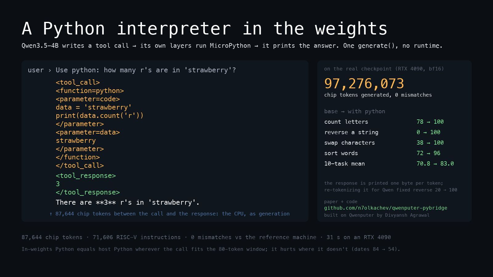

# A Python interpreter in the weights

**The P4 bridge for [Qwenputer](https://github.com/divagr18/qwenputer): MicroPython running inside Qwen3.5-4B, driven by the model's own tool calls, verified on the checkpoint, and benchmarked.**

<p align="center">
  
</p>

<p align="center">
  <a href="paper/paper.pdf"><b>Paper (PDF)</b></a> &nbsp;·&nbsp;
  <a href="promo/qwenputer-python.mp4"><b>Video of a real call</b></a> &nbsp;·&nbsp;
  <a href="bench/RESULTS.md"><b>All results</b></a> &nbsp;·&nbsp;
  <a href="https://github.com/divagr18/qwenputer"><b>Qwenputer</b></a> by Divyansh Agrawal
</p>

---

## In one minute

[Qwenputer](https://github.com/divagr18/qwenputer) is Qwen3.5-4B with a 32-bit RISC-V CPU compiled into eleven extra transformer layers, using the model's Gated DeltaNet state as RAM. The model writes a tool call in its own `<tool_call>` syntax, the compiled layers run it, and the model prints the `<tool_response>` itself: no runtime, no sandbox, plain `model.generate()`.

The published model had one tool, `calc`. MicroPython ran on the CPU in the lab, but the model could not call it. From the author's design notes:

> MicroPython has run on the standalone core and executor (P2), not yet inside the merged model; it needs a bridge build (P4).

This repository is that bridge, and what it found:

| | |
| --- | --- |
| **A `python` tool in the weights** | MicroPython boots into the firmware snapshot; each call runs in a persistent session; the model prints the output. f-strings, `s[::-1]`, `datetime`, `random`, `re` added; the parser made 19–31 % faster. |
| **Verified on the checkpoint** | bf16 on an RTX 4090: **97,276,073 chip tokens over 700 model-driven items, zero mismatches** against the reference machine. |
| **+12 points on exact-answer tasks** | Qwen3.5-4B goes from 70.8 % to 83.0 % on ten tasks; reverse a string 0 → 100, swap characters 38 → 100, count letters 78 → 100. |
| **One finding about in-weights tools** | The response is printed one byte per token, and a 4B model garbles a long string it reads that way. Re-tokenizing the response for the language layers fixes it: reverse 20 → 100. |
| **Honest limits** | The tool *hurts* where the base model is already good and the input overflows the circuit's 80-token window (dates 84 → 54). Calls take 10–60 s. |

---

## How a call runs

```
Qwen writes      <tool_call> <function=python> <parameter=code> print(data.count('r')) …
                 <parameter=data> strawberry … </tool_call>

the compiled     GO   J(41648) F0(10) F0(0) … ≈ 87,000 trace tokens, one per CPU step:
layers predict   the capture buffer is read, MicroPython parses, compiles and runs the code …
                 BYTE '<tool_response>'  BYTE '\n'  BYTE '3'  BYTE '\n'  BYTE '</tool_response>' … HALT

Qwen continues   There are 3 r's in 'strawberry'.
```

Nothing stops at `</tool_call>` and nothing outside the model runs. The next token is predicted by the chip layers (`GO`), then every CPU instruction is a few trace tokens, chosen deterministically by the compiled weights and fed back in like any generated token. When the program prints a byte, the circuit emits the Qwen token of that character, so the response lands in the model's context as text. `HALT` parks the machine and the language head takes over again. Trace tokens pass through the chip layers only; Qwen's layers never see them.

**The firmware** (`firmware/mpy/main.c`, ~250 lines on top of the author's MicroPython port):

- **Boot once, park, serve calls.** MicroPython initialises before the snapshot is taken, so boot costs nothing at inference. On each `GO` it flattens the capture rows (80 tokens × 16 bytes), finds the `code` parameter — matching the literal `</parameter>`, so code may contain `<` — and an optional `data` parameter exposed as the string `data`.
- **A persistent session.** Code runs in `__main__` with REPL semantics: bare expressions print, globals survive across calls, so a `def` in one call is usable in the next. That is how the model works within the 80-token window.
- **It always comes back.** Exceptions return as tracebacks. A budget on VM jumps and returns (3,500 per call) ends runaway code with a `longjmp` out of the interpreter — a Python exception would not do, since user `try/except` could swallow it and leave the machine un-parked. Output is capped at 1,536 bytes; deep recursion raises `RecursionError`.
- **What the model gets.** Builtins with f-strings, `math`, `sys`, `collections`, `struct`, `array`, `random` (seeded from a hash of the conversation's calls, so every roll is still in the trace), `re`, `heapq`, `hashlib.sha256`, and `datetime` frozen into the DROM as bytecode. Not `json`, `os`, `time`.

<details>
<summary>Why these additions were necessary</summary>

The stock BASIC feature level of MicroPython has **no f-strings** (a `SyntaxError`) and no `str` slices with a step, so `s[::-1]` raised `NotImplementedError`; models write both constantly, and the first benchmark run scored 0 % on reversing a string because every call errored and the model retried the same code five times. `datetime` is micropython-lib's pure-Python implementation with a `gmtime` shim (the machine has no clock; checked against CPython on 5,000 timestamps) and a `strftime` (checked on 300). The firmware is 230 KB of the 256 KB code ROM and 39 KB of the 128 KB data ROM, with ~23 KB of heap.
</details>

---

## Results

### On the checkpoint

`bench/run_gpu.py` on `divagr1925/Qwen3.5-4B-Qwenputer`, bf16, RTX 4090, the author's Triton executor (~2,800 chip tokens/s), 50 items per task, greedy, thinking off. **Base** is stock `Qwen/Qwen3.5-4B` in bf16 with no tool. **In-weights** is the model calling `python`. **Re-tokenized** is the same with `tools/retok.py` (explained below), run on the four tasks whose answers are strings.

| Task | Base bf16 | In-weights | Re-tokenized |
| --- | ---: | ---: | ---: |
| count_char | 78 | **100** | |
| reverse | 0 | 20 | **100** |
| swap_chars | 38 | 30 | **100** |
| word_sorting | 72 | **96** | 90 |
| nth_char | 98 | 98 | |
| multistep_arithmetic_two | 100 | 100 | |
| boolean_expressions | 94 | 92 | |
| object_counting | 96 | 86 | |
| date_understanding | 84 | 54 | |
| dyck_languages | 48 | 6 | 10 |
| **mean** | **70.8** | 68.2 | **83.0** |

The mean of the last column takes the re-tokenized number where it was run.

**Exact, on the real layers.** Across the 700 in-weights items the checkpoint generated 97,276,073 chip tokens with zero lock errors and zero head mismatches: at every position the chip layers produced the token the reference machine predicts, and Qwen's head never disagreed with the circuit where the circuit owns the position. The author's `calc` passes on the same GPU, and the IR replay of the first demo run is clean (88,309 positions).

**The response is printed one byte per token.** Every `putchar` is echoed as the single-character Qwen token of that byte, so a long nonsense string sits in the model's context as one token per letter. On `reverse` the tool printed the right string in **100 %** of items and the model's final answer was right in **20 %** — `rotcnufrinevuos` came back as "rotcnufrinevus". Digits are immune (Qwen tokenizes numbers one digit per token anyway, which is why the author's `calc` never met this); single characters and real words mostly are. `tools/retok.py` fixes it in the driver: the echo tokens are withheld from Qwen's layers during a run and, when the machine parks, the same text is fed to them re-tokenized. The generated stream — what the chip layers, the lockstep check and the replay see — is unchanged. **reverse 20 → 100, swap_chars 30 → 100.**

**Where the tool hurts.** With a strong bf16 base, the tool is decisive on character-level tasks and costs accuracy on `date_understanding` (84 → 54), `object_counting` (96 → 86) and `dyck` (48 → 6): tasks the base model already does well, whose inputs overflow the 80-token capture window, so the model spends its calls on errors. The window is a property of the compiled capture circuit, not of this firmware, and it is the binding limit of general computation in the weights today.

<details>
<summary>A transcript, as generated by the checkpoint</summary>

```
<tool_call>
<function=python>
<parameter=code>
data = 'strawberry'
print(data.count('r'))
</parameter>
<parameter=data>
strawberry
</parameter>
</function>
</tool_call>
<tool_response>
3
</tool_response>
<think>

</think>

There are **3** r's in 'strawberry'.
[77 text + 87,644 chip tokens, head mismatches 0, lock error None; replay ok, 88,309 positions]
```

`bench/results/gpu/` has the four demo transcripts and the run logs; `bench/results/*.weights.*`, `*.base.*` and `*.weights-retok.*` are the per-item results.
</details>

### Cost

Per call on the reference machine; trace tokens are ≈ 1.25 per instruction, and the author's executor does ~4K instructions/s on an L4 (~2,800 tokens/s measured on a 4090).

| Call | Instructions | ≈ seconds |
| --- | ---: | ---: |
| `pass` — the floor: capture, parse, compile, framing | 14.8 K | 4 |
| `print(2**100)` | 42.9 K | 11 |
| `s = "…"; count = s.count('r'); print(count)` | 79 K | 20 |
| `print(sorted('pear apple fig banana'.split()))` | 89 K | 22 |
| `import datetime` + a date sum (once per conversation) | 480 K | 120 |
| `fib(15)`, recursive | 1.5 M | 480 |

<details>
<summary>The parser was half of every call — and what was done about it</summary>

With stock MicroPython, `mp_parse` was 37–48 % of a call's instructions: for every statement the parser pushes, tries and backtracks out of each keyword-led alternative (`compound_stmt` has nine; `small_stmt` lists `expr_stmt` last of eight), and the same inside expressions. `firmware/patches/parse-first-sets.patch` adds FIRST-set pruning: `firmware/mpy/gen_first.c`, compiled on the host with the port's exact configuration so rule and token numbering match, computes for every grammar rule the set of tokens that can start it (every token, for nullable rules), and a 31-line change to `parse.c` skips an alternative, an optional rule or a list item whose rule cannot start with the current token instead of pushing it. 3 KB of table in the DROM; 19–31 % fewer instructions per call (`pass` 21.6 K → 14.8 K; the `count` call 104 K → 79 K).

Validated on the unix port: MicroPython's own test suite (`basics`, `float`, `unicode`, `misc`, `micropython` — 701 tests, 23,019 cases) gives identical results with and without the patch, and `compile()` of a typical test file is 34 % faster. The author describes a "FIRST-set parse prediction" patch in his unpublished build; this is an independent implementation.
</details>

<details>
<summary>The development run (Ollama proxy + reference machine), which drove the fixes</summary>

Before the GPU run, `bench/run.py` measured the same tasks with an Ollama Qwen3.5-4B (Q4_K_M) standing in for the model and the model's code executed on the reference machine with the real firmware — the in-weights environment exactly, simulated at ~300 K instructions/s — against host CPython as the ceiling.

| Task | Base (Q4, no tool) | python, in-weights env | python, host CPython |
| --- | ---: | ---: | ---: |
| count_char | 68 | 100 | 100 |
| reverse | 0 | 96 | 96 |
| nth_char | 94 | 98 | 98 |
| word_sorting | 60 | 98 | 98 |
| multistep_arithmetic_two | 98 | 100 | 100 |
| boolean_expressions | 86 | 92 | 96 |
| date_understanding | 52 | 62 | 64 |
| swap_chars | 24 | 64 | 74 |
| object_counting | 86 | 82 | 82 |
| dyck_languages | 26 | 24 | 28 |
| **mean** | **59.4** | **81.6** | **83.6** |

What it taught: in-weights equals host wherever the call fits the window, and every residual gap is an overflow. The fixes it forced: the str-slice patch (reverse 0 → 96), a required `data` parameter plus one example call in the system prompt — the model never followed prose instructions to write compact code (word_sorting 62 → 98) — `strftime`, and a final answer turn in the harness. What it got wrong: its Q4 base was much weaker than the bf16 base, and Ollama returned tool responses normally tokenized, which hid the byte-per-token effect. Round-by-round files are in `bench/results/round1/`, `round2/`.
</details>

---

## Verification

| Where | What | Result |
| --- | --- | --- |
| Reference machine (`chipformer.rv.ref`, the spec the circuit is verified against) | smoke sequence: bigints, persistent globals, sorting, string ops, a traceback, an infinite loop, deep recursion, a call after each | as expected; the machine parks after every call |
| The compiled circuit (IR evaluator, teacher-forced; the author's `test_rv_bridge.py` method) | six sessions across the firmware's builds: 25,623 + 348,832 + 292,759 + 748,691 + 725,464 + 121,571 tokens | **0 owner mismatches, 0 prediction mismatches** (`verification/`) |
| The checkpoint, bf16, RTX 4090, Triton executor | 700 benchmark items and four demos, driven by the model's own calls | **97,276,073 chip tokens, 0 lock errors, 0 head mismatches**; IR replay of the first run clean |
| MicroPython's test suite, unix port | the parser and string patches | 701 tests / 23,019 cases identical to stock (one `non_compliant.py` case now passes where it asserted the old limitation) |

---

## What's in the repository

| Path | What |
| --- | --- |
| `firmware/mpy/main.c` | the bridge firmware |
| `firmware/mpy/` | the port (from the author's `env/mpy/`), `gen_first.c`, `manifest.py`, `modules/datetime.py` |
| `firmware/patches/` | `parse-first-sets.patch`, `str-slice-step.patch` for MicroPython |
| `firmware/build.sh` | host build with brew's `riscv64-elf-gcc` and Debian's picolibc package |
| `build/mpy-bridge.elf` | the shipped firmware |
| `tools/run_ref.py` | drive calls through the bridge on the reference machine, with costs |
| `tools/check_circuit.py` | the circuit-vs-reference check |
| `tools/profile_ref.py` | instructions per function for a call |
| `tools/chat_py.py`, `tools/retok.py` | the GPU driver (`--executor`, `--retokenize`) and the re-tokenized-response variant |
| `bench/` | tasks, harnesses (`run.py` proxy, `run_gpu.py` checkpoint), every result file, `RESULTS.md` |
| `gpu/` | pod setup and the three benchmark loops |
| `verification/` | circuit-check results per build |
| `paper/` | the write-up: `paper.md`, `paper.pdf`, `make.sh` |
| `promo/` | the video and card, rendered from the real token stream |

---

## Reproduce

<details>
<summary>Build and verify locally (macOS; a CPU is enough)</summary>

```bash
brew install riscv64-elf-gcc
git clone --depth 1 https://github.com/divagr18/qwenputer
(cd qwenputer/experimental/riscv && uv sync --extra hf)
git clone --depth 1 https://github.com/micropython/micropython third_party/micropython
# picolibc for rv32im/ilp32 from Debian's arch-independent package (on Linux: apt install
# picolibc-riscv64-unknown-elf and point PICO at /usr/lib/picolibc/riscv64-unknown-elf)
mkdir -p third_party/picolibc && cd third_party/picolibc && \
  curl -O https://deb.debian.org/debian/pool/main/p/picolibc/picolibc-riscv64-unknown-elf_1.8.12-1_all.deb && \
  ar x *.deb && tar xf data.tar.xz && cd ../..

RUN="uv run --project qwenputer/experimental/riscv python"
firmware/build.sh                                   # build/mpy-bridge.elf
$RUN tools/run_ref.py                               # the smoke sequence on the reference machine
$RUN tools/run_ref.py "print(2**100)" "x = 1" "x"   # your own calls
$RUN tools/check_circuit.py "pass"                  # the circuit == the reference (84 s on CPU)
$RUN tools/profile_ref.py "print(2**100)" --warm    # instructions by function

ollama pull qwen3.5:4b
bench/run_all.sh 50                                 # the proxy benchmark, every task x mode
```
</details>

<details>
<summary>The checkpoint, on a CUDA GPU with 24 GB (~$12 on a rented 4090)</summary>

```bash
bash gpu/setup_l4.sh                                # deps, checkpoint, the author's calc check, two demos
RUN="uv run --project qwenputer/experimental/riscv python"
$RUN tools/chat_py.py qwenputer-rv --executor --retokenize --ask "Use python: reverse 'davenportwalkie'"
N=50 bash gpu/bench_pod.sh && bash gpu/base_pod.sh && bash gpu/retok_pod.sh   # the three columns
python3 bench/summarize.py                          # bench/RESULTS.md
```
</details>

---

## Credits and license

Built on [Qwenputer](https://github.com/divagr18/qwenputer) by Divyansh Agrawal (MIT); the model is [divagr1925/Qwen3.5-4B-Qwenputer](https://huggingface.co/divagr1925/Qwen3.5-4B-Qwenputer) (Apache-2.0). The MicroPython port files start from his `env/mpy/`. [MicroPython](https://micropython.org) and micropython-lib's `datetime` are MIT; [picolibc](https://github.com/picolibc/picolibc) is BSD; the BIG-Bench-Hard tasks are Apache-2.0.

This repository is MIT — see [LICENSE](LICENSE).
